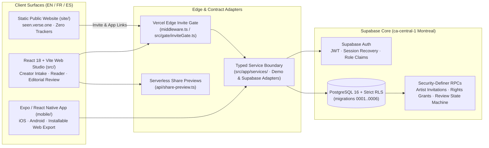

# SEEN by CREOVA

[](https://github.com/creova-studios/seen/actions/workflows/ci.yml)
[](LICENSE)

Multilingual (`EN` / `FR` / `ES`) community story worlds — immersive cultural narratives, audio-led reading, artist-invited publishing, editorial moderation, curated collections, and verified funding resources for storytellers.

| Surface | URL / Location | Role |
| --- | --- | --- |
| **Website** | [https://seen.verse.one](https://seen.verse.one) ([`site/`](site/)) | Public customer-facing website (`EN` / `FR` / `ES`, zero third-party trackers) |
| **App Testing (Vercel)** | [https://seen-sigma-eight.vercel.app](https://seen-sigma-eight.vercel.app) ([`vercel.json`](vercel.json)) | Hosted on Vercel for testing the installable app export and web Creator Studio |
| **Mobile App (iOS & Android)** | [`mobile/`](mobile/) (`com.creova.seen`) | Native Expo SDK 58 / React Native application for Expo Go, TestFlight, and Google Play |
| **Design System** | Figma `seen.io` (`8WMBpUhanDkUjodZYolyDT`) | Tokens ([`src/styles/seen-tokens.css`](src/styles/seen-tokens.css)) & primitives ([`src/app/components/seen/`](src/app/components/seen/)) |

---

## Multi-Surface Architecture



### Implementation Status Matrix

| Subsystem | Location | Status |
| --- | --- | --- |
| **Multilingual Reader, Audio Narration & Guest Mode (`EN`/`FR`/`ES`)** | `src/app/`, `mobile/src/` | **Implemented & Verified** |
| **Artist Invitation, Story Intake, Rights Grants & Editorial Review** | `supabase/migrations/0006_artist_intake_and_moderation.sql`, `src/app/data/storyService.ts` | **Implemented & Verified** |
| **PostgreSQL 16 Schema, Adversarial RLS & Account Deletion** | `supabase/migrations/0001..0006`, `supabase/tests/rls.test.sql` | **Implemented & Verified** |
| **Native Mobile App (iOS / Android / Web Export)** | `mobile/` | **Implemented & Verified** |
| **Public Website (`seen.verse.one`)** | `site/` | **Implemented & Verified** |
| **Local Browser Demo Store (`?simulate=offline\|error\|slow`)** | `src/app/services/demo/` | **Deterministic Simulator / Offline Fallback** |
| **GCP Cloud Storage / CDN Media Offload (`northamerica-northeast1`)** | [`docs/adr/ADR-003-cloud-architecture-supabase-gcp.md`](docs/adr/ADR-003-cloud-architecture-supabase-gcp.md) | **Planned / Roadmap (Option C Hybrid)** |

---

## Engineering Decisions

Architectural decisions are recorded in [`docs/adr/`](docs/adr/):
- [`ADR-001-frontend-consolidation.md`](docs/adr/ADR-001-frontend-consolidation.md) — Shared domain data & token consolidation between Web (`src/`) and Native Mobile (`mobile/`).
- [`ADR-002-backend-adapter-boundary.md`](docs/adr/ADR-002-backend-adapter-boundary.md) — Strict service contract boundary supporting both deterministic offline/demo mode and live Supabase persistence.
- [`ADR-003-cloud-architecture-supabase-gcp.md`](docs/adr/ADR-003-cloud-architecture-supabase-gcp.md) — Cloud architecture selection (`ca-central-1` Supabase Core + hybrid GCP media/compute path).

1. **Database-Enforced Authorization & Editorial State Machine Over Custom Middleware:**
   - Rather than trusting client role metadata or maintaining a separate Hono/KV Edge Function, role protection (`viewer`, `creator`, `moderator`, `admin`), SHA-256 single-use artist invitations (`create_artist_invitation`, `redeem_artist_invitation`), append-only creator rights grants (`rights_grants`), and story publication transitions (`draft -> submitted -> in_review -> changes_requested -> approved -> published`) are enforced directly by PostgreSQL 16 Row-Level Security (`RLS`) and `security definer` RPCs (`supabase/migrations/0001`–`0006`), tested on every CI run against a real PostgreSQL 16 engine (`supabase/tests/rls.test.sql`).
2. **Dual-Adapter Service Boundary (`Demo` + `Supabase`):**
   - All UI surfaces talk to typed service contracts (`src/app/services/`). When `VITE_SUPABASE_URL` is unconfigured, the app runs against a deterministic local adapter with seeded accounts and `?simulate=offline|error|slow` fault injection, enabling zero-flake Playwright E2E and WCAG 2.2 AA accessibility verification in CI.
3. **Zero-Tracker Static Public Site (`site/`):**
   - The marketing and artist-information surface (`seen.verse.one`) builds from zero external dependencies (`site/build.mjs`) and is verified by 28 `node:test` assertions enforcing translation parity (`EN`/`FR`/`ES`), valid landmarks, and zero third-party network requests.

---

## Repository Structure

```text
.
├── src/                  # Shared story catalogue, i18n (EN/FR/ES), service contracts, and web app
├── mobile/               # Native iOS & Android app (Expo SDK 58 / React Native) + web export
├── site/                 # Customer-facing static website for seen.verse.one (zero dependencies)
├── api/                  # Vercel serverless endpoints (share preview cards)
├── supabase/             # Database migrations (0001..0006) and PostgreSQL 16 RLS test suite
├── e2e/ & e2e-native/    # Playwright end-to-end journeys, responsive audits, and axe WCAG 2.2 AA scans
└── docs/                 # ADRs (docs/adr/), master audit, product specs, security, and operations
```

---

## Quick Start

### 1. Web & Shared Core (`src/`)

```bash
npm install
npm run dev          # Start local Vite dev server (http://localhost:5173)
npm run check        # Run typecheck + Vitest unit/component suite (240 tests) + production build
npm run test:db      # Run PostgreSQL 16 migrations + adversarial RLS test suite
npm run test:e2e     # Run Playwright journeys + axe WCAG 2.2 AA accessibility scans
```

- **Demo test accounts** (per-browser demo store, password `SeenDemo2026!`):
  - `viewer@seen.demo` · `creator@seen.demo` · `moderator@seen.demo` · `admin@seen.demo`
- Append `?simulate=offline|error|slow` to any URL to test resilience and failure states.

### 2. Native Mobile App (`mobile/`)

```bash
cd mobile
npm install --legacy-peer-deps
npx expo start --lan         # Scan QR code in Expo Go (iOS Camera / Android Expo Go)
npm run typecheck            # Typecheck native React Native screens and audio player
npm test                     # Run Jest + React Native Testing Library suite (26 tests)
```

To build and verify the installable web export served on Vercel for testing:

```bash
cd mobile && npx expo export --platform web --output-dir dist && cd ..
node scripts/pwa-postbuild.mjs mobile/dist
npx playwright test -c playwright.native.config.ts
```

### 3. Public Website (`site/` → `seen.verse.one`)

```bash
cd site
npm run build        # Generates static EN/FR/ES pages, sitemap.xml, and CNAME (seen.verse.one) in site/dist/
npm run check        # Runs 28 node:test checks (translation parity, links, a11y, zero third-party requests)
```

---

## Branching & Deployment Workflow

- **`main`** — Canonical releasable branch deployed to the Vercel testing channel ([https://seen-sigma-eight.vercel.app](https://seen-sigma-eight.vercel.app)).
- **`staging`** — Release-candidate branch (`seen-git-staging-creovas-projects.vercel.app`).
- **`dev`** — Integration branch for ongoing engineering (`seen-git-dev-creovas-projects.vercel.app`).
- **`feature/*` & `fix/*`** — Branched from `dev` and merged back via pull request with required CI checks (`Typecheck · unit tests · build`, `Native app · typecheck · tests · bundle`, `Database RLS tests · secret scan`, `End-to-end journeys`).

Full workflow and release steps: [`docs/operations/BRANCHING.md`](docs/operations/BRANCHING.md) and [`docs/operations/REPOSITORY_MAP.md`](docs/operations/REPOSITORY_MAP.md).

---

## Documentation & Governance

- **Architecture & Master Audit:** [`docs/README.md`](docs/README.md) · [`docs/adr/ADR-003-cloud-architecture-supabase-gcp.md`](docs/adr/ADR-003-cloud-architecture-supabase-gcp.md) · [`docs/master-audit/ARCHITECTURE_AS_IS.md`](docs/master-audit/ARCHITECTURE_AS_IS.md)
- **Product & Roadmap:** [`docs/product/SEEN_PRODUCT_REQUIREMENTS.md`](docs/product/SEEN_PRODUCT_REQUIREMENTS.md) · [`docs/product/MASTER_FEATURE_MATRIX.md`](docs/product/MASTER_FEATURE_MATRIX.md) · [`docs/product/STANDALONE_BETA_ROADMAP.md`](docs/product/STANDALONE_BETA_ROADMAP.md)
- **Release & Mobile:** [`docs/release/RELEASE_READINESS.md`](docs/release/RELEASE_READINESS.md) · [`docs/operations/MOBILE.md`](docs/operations/MOBILE.md) · [`mobile/README.md`](mobile/README.md)
- **Security, Contributing & License:** [`SECURITY.md`](SECURITY.md) · [`CONTRIBUTING.md`](CONTRIBUTING.md) · [`CHANGELOG.md`](CHANGELOG.md) · [`LICENSE`](LICENSE)
- **Agent Conventions:** [`CLAUDE.md`](CLAUDE.md) · [`AGENTS.md`](AGENTS.md) · [`.ai/project.yaml`](.ai/project.yaml)
