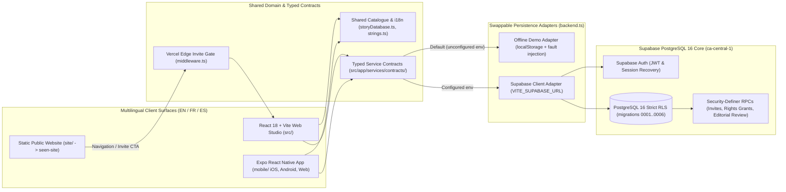

# SEEN by CREOVA

[](https://github.com/creova-studios/seen/actions/workflows/ci.yml)
[](LICENSE)

Multilingual (`EN` / `FR` / `ES`) interactive storytelling platform by **CREOVA Studios** — immersive cultural story worlds, chapter-synced audio narration, artist-invited publishing, editorial moderation, curated collections, and verified Canadian funding resources for storytellers.

| Surface | URL / Location | Role |
| --- | --- | --- |
| **Public Website** | [https://seen.creova.one](https://seen.creova.one) · [https://seen.verse.one](https://seen.verse.one) ([`site/`](site/) → [`creova-studios/seen-site`](https://github.com/creova-studios/seen-site)) | Zero-tracker static `EN` / `FR` / `ES` website (`default-src 'none'` CSP) |
| **Web App & Creator Studio** | [https://seen-sigma-eight.vercel.app](https://seen-sigma-eight.vercel.app) ([`src/`](src/), [`vercel.json`](vercel.json)) | Moderated testing build (per-browser `demo` adapter by default; `supabase` RLS adapter when configured) |
| **Native Mobile App** | [`mobile/`](mobile/) (`com.creova.seen`) | Expo SDK 58 / React Native iOS, Android, and installable web export sharing core TypeScript domain contracts |
| **Design System** | [`src/styles/seen-tokens.css`](src/styles/seen-tokens.css) · [`src/app/components/seen/`](src/app/components/seen/) | Shared design tokens, WCAG 2.2 AA contrast primitives, and responsive organisms |

---

## Implementation vs. Demo Adapter vs. Supabase RLS Status Matrix

> [!NOTE]
> **Current Deployment Mode (`RELEASE_READINESS.md`):** Until `VITE_SUPABASE_URL` and `VITE_SUPABASE_ANON_KEY` are provisioned on production hosting, the Vercel testing deployment runs the deterministic per-browser **`demo` adapter** (`localStorage` + seeded test roles) for moderated user testing. PostgreSQL 16 migrations (`0001`–`0006`) and adversarial Row-Level Security (`RLS`) tests execute against a live `postgres:16-alpine` instance on every CI run.

| Capability / Subsystem | Code Location | Current Mode & Verification Status |
| --- | --- | --- |
| **Multilingual Story Reader, Audio Narration & Guest Mode (`EN`/`FR`/`ES`)** | `src/app/`, `mobile/src/` | **Implemented & Verified** (Vitest + Jest + Playwright E2E + `axe` WCAG 2.2 AA) |
| **Creators, Thematic/Institutional Collections & 12 Sourced Funding Listings** | `src/app/data/`, `src/app/services/data/fundingListings.ts` | **Implemented & Verified** (real published Canadian funding URLs & verification dates) |
| **Artist Invitations, Rights Grants & Editorial Moderation Workflow** | `src/app/data/storyService.ts`, `supabase/migrations/0006_artist_intake_and_moderation.sql` | **Implemented & Verified** (Web + Native intake UI + PostgreSQL RPC state machine) |
| **Offline / Per-Browser `demo` Adapter (`?simulate=offline\|error\|slow`)** | `src/app/services/demo/` | **Active Default Adapter** (deterministic `localStorage` persistence & fault injection; zero server required) |
| **PostgreSQL 16 Schema, `security definer` RPCs & `supabase` RLS Adapter** | `src/app/services/supabase/`, `supabase/migrations/0001..0006`, `supabase/tests/rls.test.sql` | **Implemented & CI-Verified on Postgres 16** (activates automatically when `VITE_SUPABASE_URL` + `VITE_SUPABASE_ANON_KEY` are set) |
| **Edge Demo Invite Gate & Serverless Share Previews** | `middleware.ts`, `src/gate/inviteGate.ts`, `api/share-preview.ts` | **Implemented & Verified** (zero third-party runtime dependencies) |
| **Zero-Dependency Static Public Website (`EN`/`FR`/`ES`)** | `site/` (`build.mjs`, `check/site.check.mjs`) | **Implemented & Verified** (28 `node:test` parity, link, a11y, and zero-tracker checks) |
| **GCP Cloud Storage / CDN Media Offload (`northamerica-northeast1`)** | [`docs/adr/ADR-003-cloud-architecture-supabase-gcp.md`](docs/adr/ADR-003-cloud-architecture-supabase-gcp.md) | **Planned / Roadmap** (Phase 2 media offload under Option C hybrid architecture) |

---

## System Architecture

Web (`src/`) and Expo React Native (`mobile/`) share a single typed domain catalogue and service contract layer (`src/app/services/contracts/`), cleanly decoupled from whether persistence is served by the deterministic local `demo` adapter or the PostgreSQL 16 `supabase` RLS adapter:



---

## Engineering Decisions & Trade-Offs

Full Architecture Decision Records live in [`docs/adr/`](docs/adr/):
- [`ADR-001-frontend-consolidation.md`](docs/adr/ADR-001-frontend-consolidation.md) — Consolidating story domain models, i18n strings, and design tokens across Web (`src/`) and Native Mobile (`mobile/`).
- [`ADR-002-backend-adapter-boundary.md`](docs/adr/ADR-002-backend-adapter-boundary.md) — Typed repository/service adapter boundary decoupling UI components from storage transport.
- [`ADR-003-cloud-architecture-supabase-gcp.md`](docs/adr/ADR-003-cloud-architecture-supabase-gcp.md) — Selecting Montreal (`ca-central-1`) Supabase Postgres Core with planned GCP CDN media offload.

### Key Architectural Trade-Offs

1. **Shared TypeScript Domain Core Across Web (React 18 / Vite) and Mobile (Expo / React Native 0.88):**
   - *Decision:* Keep `mobile/` in its own isolated dependency graph (`mobile/package-lock.json`) while importing pure TypeScript story schemas, localization tables, and intake contracts from `../src/app/`.
   - *Trade-off:* Avoids monorepo workspace hoisting conflicts between Vite/React 18 web packages and Expo SDK 58/React 19 native packages, at the cost of running two explicit `npm ci` lockfile installs in CI.
2. **Dual-Adapter Boundary (`demo` vs. `supabase`) Instead of Mocking `fetch` in UI Tests:**
   - *Decision:* UI screens never import `@supabase/supabase-js` directly; all reads and optimistic mutations flow through `src/app/services/backend.ts`.
   - *Trade-off:* Moderated user testing, offline previews, and Playwright + `axe-core` E2E suites run deterministically with zero external network flakiness (`?simulate=offline|error|slow`), while real multi-tenant security is proven independently against PostgreSQL 16 (`npm run test:db`).
3. **Database-Enforced Authorization & Editorial State Machine Over Custom API Middleware:**
   - *Decision:* Retired the legacy Edge Function KV server in favor of PostgreSQL 16 Row-Level Security (`RLS`) and `security definer` RPCs (`create_artist_invitation`, `redeem_artist_invitation`, `submit_story_for_review`, `review_story_submission`).
   - *Trade-off:* Eliminates an entire tier of middle-layer auth bugs—clients cannot self-promote to `moderator`/`admin` or set `stories.status = 'published'` even with a valid anon/user JWT—verified by adversarial cross-tenant SQL assertions in `supabase/tests/rls.test.sql`.
4. **Zero-Dependency Static Public Website (`site/` → `creova-studios/seen-site`):**
   - *Decision:* Generate all 9 `EN`/`FR`/`ES` marketing and legal pages via a 69-line Node stdlib builder (`site/build.mjs`) enforcing `default-src 'none'` CSP.
   - *Trade-off:* Zero supply-chain attack surface, instant sub-second builds, and zero third-party cookies or trackers on the public domain.

---

## Repository Structure

```text
.
├── src/                  # Shared story catalogue, i18n (EN/FR/ES), typed service contracts, and Vite web app
├── mobile/               # Native iOS & Android app (Expo SDK 58 / React Native) + installable web export
├── site/                 # Zero-dependency static site generator & 28-assertion suite for seen.creova.one
├── api/                  # Vercel serverless endpoints (OpenGraph share preview cards)
├── supabase/             # PostgreSQL 16 migrations (0001..0006) and adversarial RLS test suite
├── e2e/ & e2e-native/    # Playwright end-to-end journeys, viewport overflow checks, and axe WCAG 2.2 AA scans
├── scripts/              # CI secret scanner, PWA postbuild, and screen-matrix verification utilities
└── docs/                 # ADRs (docs/adr/), security threat models, release readiness, and operations guides
```

---

## Prerequisites & Reproducible Quick Start

- **Node.js** `>= 22` and **npm** `>= 10`
- **PostgreSQL 16** client/server (`psql`) only when running `npm run test:db` locally

### 1. Web Studio & Shared Core (`src/`)

```bash
npm ci
npm run dev          # Start local Vite dev server (http://localhost:5173)
npm run check        # Run tsc --noEmit + Vitest unit/component suite (240 tests) + production build
npm run test:e2e     # Run Playwright journeys + axe-core WCAG 2.2 AA accessibility scans
```

- **Seeded local `demo` accounts** (password `SeenDemo2026!`):
  - `viewer@seen.demo` · `creator@seen.demo` · `moderator@seen.demo` · `admin@seen.demo`
- Append `?simulate=offline|error|slow` to any URL to verify resilience and rollback states.
- Copy [`.env.example`](.env.example) to `.env.local` and set `VITE_SUPABASE_URL` + `VITE_SUPABASE_ANON_KEY` to switch from the `demo` adapter to a live Supabase project.

### 2. Native Mobile App (`mobile/`)

```bash
cd mobile
npm ci --legacy-peer-deps
npx expo start --lan         # Launch in Expo Go (iOS / Android)
npm run typecheck            # Typecheck native screens, navigation, and audio player
npm test                     # Run Jest + React Native Testing Library suite (26 tests)
```

### 3. Static Public Website (`site/`)

```bash
cd site
npm run build        # Generates static EN/FR/ES bundle in site/dist/
npm run check        # Runs 28 node:test assertions (translation parity, CSP, links, zero trackers)
```

### 4. Database Migrations, Adversarial RLS & Secret Scan (`supabase/`)

```bash
npm run test:db              # Applies migrations 0001..0006 and runs supabase/tests/rls.test.sql
bash scripts/secret-scan.sh  # Verifies zero leaked service-role keys or private keys in git
```

---

## Security, Branching & Governance

- **Security Policy & Threat Model:** [`SECURITY.md`](SECURITY.md) · [`docs/security/THREAT_MODEL.md`](docs/security/THREAT_MODEL.md) · [`docs/security/AUTHORIZATION_MATRIX.md`](docs/security/AUTHORIZATION_MATRIX.md)
- **Branching & Release Readiness:** [`docs/operations/BRANCHING.md`](docs/operations/BRANCHING.md) · [`docs/release/RELEASE_READINESS.md`](docs/release/RELEASE_READINESS.md)
  - `feature/*` & `fix/*` → PR with passing 4-job CI (`verify`, `native`, `database`, `e2e`) → `dev` → `staging` → `main`.
- **Contributing, Agent Contract & License:** [`CONTRIBUTING.md`](CONTRIBUTING.md) · [`AGENTS.md`](AGENTS.md) · [`CLAUDE.md`](CLAUDE.md) · [`CHANGELOG.md`](CHANGELOG.md) · [`LICENSE`](LICENSE) (Proprietary — Copyright © 2026 CREOVA Studios Inc. All rights reserved.)
