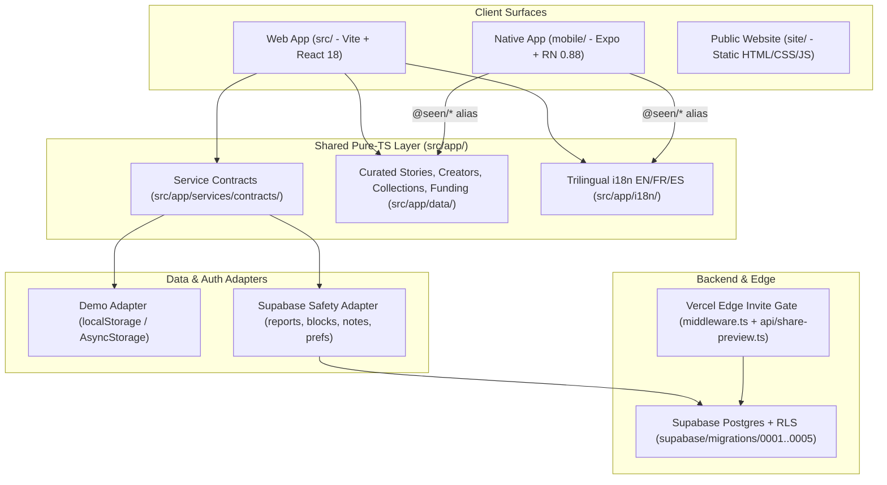

# ARCHITECTURE_AS_IS.md — SEEN by CREOVA

**Audit Date:** 2026-11-15

---

## 1. Monorepo Topology

---

## 2. Layer-by-Layer Analysis

### 2.1 Web Application (`src/`)
- **Routing:** Hash-based router ([routes.ts](file:///Users/justinmafie/seen-v1/src/app/navigation/routes.ts)) managed inside [App.tsx](file:///Users/justinmafie/seen-v1/src/app/App.tsx).
- **State & Persistence:**
  - `SeenOSContext.tsx` manages onboarding step, user role (`viewer`, `creator`, `moderator`, `admin`), language (`en`, `fr`, `es`), accessibility, and story progress snapshots in `localStorage`.
  - [src/app/services/index.ts](file:///Users/justinmafie/seen-v1/src/app/services/index.ts) exports `api: SeenApi`, combining `demoAdapter` with `createSupabaseSafety(lazySafetyDb())` when `VITE_BACKEND=supabase`.

### 2.2 Native Mobile Application (`mobile/`)
- **Entrypoint:** [mobile/App.tsx](file:///Users/justinmafie/seen-v1/mobile/App.tsx) renders `<NativeApp />` ([mobile/src/native/NativeApp.tsx](file:///Users/justinmafie/seen-v1/mobile/src/native/NativeApp.tsx)).
- **Code Sharing:** [mobile/metro.config.js](file:///Users/justinmafie/seen-v1/mobile/metro.config.js) watches the monorepo root and maps `@seen/*` to `../src/app/*`.
- **Storage & Auth:** [mobile/src/native/storage.tsx](file:///Users/justinmafie/seen-v1/mobile/src/native/storage.tsx) persists `seen.native.v1` and `seen.native.accounts.v1` in `@react-native-async-storage/async-storage`, and [polyfill.ts](file:///Users/justinmafie/seen-v1/mobile/src/native/polyfill.ts) mirrors `localStorage` keys so `@seen/data/userStoriesService` works on device.

### 2.3 Serverless & Edge (`middleware.ts`, `api/`)
- [middleware.ts](file:///Users/justinmafie/seen-v1/middleware.ts) enforces an optional invite token gate (`DEMO_INVITE_TOKENS`) on Vercel deployments.
- [api/share-preview.ts](file:///Users/justinmafie/seen-v1/api/share-preview.ts) renders OpenGraph HTML previews for shared stories from `_curated-previews.json` or Supabase `public_stories`.

### 2.4 Database (`supabase/migrations/`)
- `0001_core_schema.sql`: `profiles`, `stories`, `chapters`, `public_stories`, `blocks`, `notes`, `reports`, `audit_log`, `notification_prefs`, `resolve_report()`, `delete_my_account()`.
- `0002_block_note_sender.sql`: `block_note_sender(uuid)` security definer RPC allowing creators to block anonymous note senders without learning their `sender_id`.
- `0003_adapter_columns.sql`: adds `reports.target_title`, `notes.sender_named`, `notes.sender_name`, and revokes direct `sender_id` select on `notes`.
- `0004_new_user_profile.sql`: trigger on `auth.users` insert creating a default `viewer` row in `public.profiles`.
- `0005_profile_bio.sql`: adds `bio text check (char_length(bio) <= 400)` to `public.profiles`.
