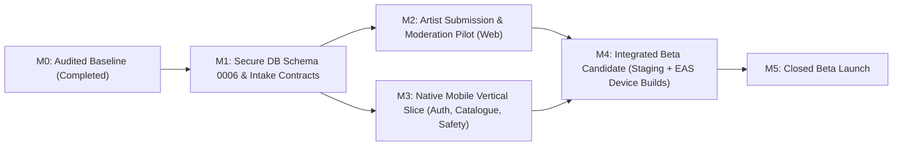

# BETA_GAP_ANALYSIS.md — SEEN by CREOVA (Phases 7 & 8)

**Audit Date:** 2026-11-15

---

## 1. Beta Acceptance Gate Status (10 Required Criteria)

| # | Beta Acceptance Criterion | Current Status | Blocking Gap | Target Milestone |
|---|---|---|---|---|
| 1 | Invited creator can onboard | **Partial** (UI works; needs DB invite token redemption) | `public.invitations` + `redeem_artist_invitation()` RPC | **M1 / M2** |
| 2 | Creator can submit original story with recorded permissions | **Partial** (5-step wizard exists; writes only to `localStorage`) | `public.rights_grants` + `submit_story_for_review()` + Supabase adapter | **M1 / M2** |
| 3 | Authorized moderator can review and publish it | **Missing** (Moderators can resolve reports, not review story submissions) | `public.story_reviews` + `review_story_submission()` RPC + Staff Review UI | **M2** |
| 4 | Reader can discover and read published story on iOS & Android | **Partial** (Mobile reader works on curated + local stories; needs Supabase catalogue fetch) | Supabase catalogue adapter in `src/app/services/supabase/` shared with `mobile/` | **M3** |
| 5 | Reading state persists across sessions | **Working locally** (`localStorage` / `AsyncStorage`); needs user-account sync | Optional `reading_progress` table / profile sync | **M3** |
| 6 | Users cannot access unauthorized content | **Partial** (`stories_read` RLS blocks drafts, but `stories_insert` allows self-publish) | Migration `0006` locking `published` transition to staff + adversarial RLS tests | **M1** |
| 7 | Account deletion and story withdrawal work | **Partial** (`delete_my_account()` exists in SQL; story `withdraw_story()` RPC + UI wiring needed) | Add `withdraw_story()` RPC in Migration `0006` + wire UI buttons | **M1 / M2** |
| 8 | Relevant CI and physical-device tests pass | **Working in CI/Local** (Web + Mobile unit/typecheck/build + `verify-seen` pass) | Run EAS internal preview build on physical iOS & Android devices | **M4** |
| 9 | Backups, monitoring and rollback are demonstrated | **Partial** (Migration SQL files + `observability.ts` exist; staging DB restore drill needed) | Document and test `pg_dump`/PITR restore on staging Supabase project | **M4 / M5** |
| 10 | No critical/high security or data-integrity blockers remain | **In Progress** (`SEC-01`, `SEC-02`, `SEC-03` addressed in Migration `0006`) | Execute full adversarial RLS suite against PostgreSQL | **M1** |

---

## 2. Prioritized Execution Backlog (Phase 8)

### P0 — Blocks Artist Intake or Security

| Task ID | Objective | Scope & Relevant Files | Dependencies | Effort / Confidence | Acceptance Criteria & Verification | Risk & Rollback | Suitable Agent |
|---|---|---|---|---|---|---|---|
| **P0-01** | **Baseline Recovery & Verification Harness (`M0`)** | Repair merge regressions in [OnboardingPurpose.tsx](file:///Users/justinmafie/seen-v1/src/app/components/OnboardingPurpose.tsx), [e2e/core-journeys.spec.ts](file:///Users/justinmafie/seen-v1/e2e/core-journeys.spec.ts), integrate `site/` and `middleware.ts`, and prove `verify-seen` across app & website. | None | S (High) | `npm run typecheck`, `npm test`, `npm run build`, `cd site && npm run check`, `cd mobile && npm run typecheck && npx jest`, `control-seen` live proof. **COMPLETED.** | Low; revert commit on branch. | Principal Architect / QA |
| **P0-02** | **Migration `0006`: Artist Invitations, Rights Grants & Editorial State Machine (`M1`)** | Create [0006_artist_intake_and_moderation.sql](file:///Users/justinmafie/seen-v1/supabase/migrations/0006_artist_intake_and_moderation.sql) and expand [rls.test.sql](file:///Users/justinmafie/seen-v1/supabase/tests/rls.test.sql) with all 8 Phase 5 adversarial test cases. | `P0-01` | M (High) | All 8 adversarial authorization cases enforced by Postgres RLS + `security definer` RPCs (`redeem_artist_invitation`, `submit_story_for_review`, `review_story_submission`, `withdraw_story`). | Medium; down-migration script drops new tables/functions and restores `0005` constraints. | Backend / Security Engineer |
| **P0-03** | **Shared Typed Intake & Moderation Service Contract (`M1`)** | Create [intake.ts](file:///Users/justinmafie/seen-v1/src/app/services/contracts/intake.ts), demo implementation in [src/app/services/demo/](file:///Users/justinmafie/seen-v1/src/app/services/demo/), and Supabase implementation in [src/app/services/supabase/intake.ts](file:///Users/justinmafie/seen-v1/src/app/services/supabase/intake.ts) + unit tests. | `P0-02` | M (High) | `npm run typecheck` and `npm test` verify full state machine transitions (`draft → submitted → in_review → changes_requested → approved → published / rejected / withdrawn`) and role checks. | Low; additive service module under `api.intake`. | Principal / Full-Stack Engineer |
| **P0-04** | **Web Creator Intake & Staff Moderation UI Wiring (`M2`)** | Wire `/#/creator-publish` and `/#/creator-stories` ([CreatorPublishFlowScreen.tsx](file:///Users/justinmafie/seen-v1/src/app/screens/CreatorPublishFlowScreen.tsx), [CreatorStoriesScreen.tsx](file:///Users/justinmafie/seen-v1/src/app/screens/CreatorStoriesScreen.tsx)) to `api.intake` (invite redemption, rights grant, submit for review, moderator review actions, withdrawal). | `P0-03` | M (High) | Live `control-seen` proof + Vitest/Playwright test showing invited artist submitting a story, moderator requesting changes, artist revising, and moderator publishing. | Low; preserves existing 5-step wizard layout. | Frontend / Product Engineer |

### P1 — Required for Native Mobile Beta

| Task ID | Objective | Scope & Relevant Files | Dependencies | Effort / Confidence | Acceptance Criteria & Verification | Risk & Rollback | Suitable Agent |
|---|---|---|---|---|---|---|---|
| **P1-01** | **Mobile Secure Session Storage & Supabase Auth Wiring (`M3`)** | Add `expo-secure-store` adapter to `mobile/src/native/storage.tsx` and wire `mobile/src/native/auth.ts` to Supabase Auth when `EXPO_PUBLIC_SUPABASE_URL` is configured. | `P0-03` | M (High) | Mobile Jest tests + simulator verification of sign-up, sign-in, session restore, and `delete_my_account`. | Low; falls back to local store in offline test mode. | Senior React Native Engineer |
| **P1-02** | **Mobile Production Catalogue & Reading Sync (`M3`)** | Wire `mobile/src/native/data.ts` and `Create.tsx` to `api.intake` so published artist stories from Supabase appear in `ForYou`/`Explore` and reading progress syncs. | `P0-03`, `P1-01` | M (High) | Published story from `P0-04` renders in mobile `ForYou`, `Story`, and `Reader` with creator attribution. | Low; static curated stories remain fallback when offline. | Senior React Native Engineer |
| **P1-03** | **Mobile Safety Actions: Report Story/Creator & Block Creator (`M3`)** | Add Report and Block sheets on mobile `Story.tsx` and `Creator.tsx` wired to `api.reports` and `api.blocks` (required by Apple App Store Guideline 1.2 for UGC apps). | `P1-01` | S (High) | Mobile Jest test + runtime check confirming report submission and immediate filtering of blocked creator content. | Low; backend RLS & adapter already exist (`safety.ts`). | Senior React Native Engineer |
| **P1-04** | **EAS Build & Physical Device Verification (`M4`)** | Validate `npx expo-doctor`, align native SDK versions if needed, run EAS internal preview builds for iOS (TestFlight) and Android (Internal Testing). | `P1-01`, `P1-02`, `P1-03` | M (Medium) | Clean iOS `.ipa` and Android `.aab`/`.apk` builds installed and verified on physical devices. | Medium; isolate dependency version pins in a dedicated PR. | React Native / Release Engineer |

### P2 — Valuable Beta Enhancements
- **P2-01:** Signed media upload pipeline for cover art and chapter audio (`story-media` bucket in Supabase Storage / GCS).
- **P2-02:** Email / push notifications for editorial status changes (`submitted` → `changes_requested` / `published`).
- **P2-03:** Consolidate shared EN/FR/ES UI strings between `src/app/i18n/` and `mobile/src/native/data.ts`.

### P3 — Post-Beta Expansion
- **P3-01:** Interactive branching narratives (`branchChoices` authoring and reader UI).
- **P3-02:** Direct creator patronage / tipping and paid membership tiers.
- **P3-03:** Automated server-side TTS narration generation pipeline on GCP Cloud Run.

---

## 3. Milestone Dependency Graph

